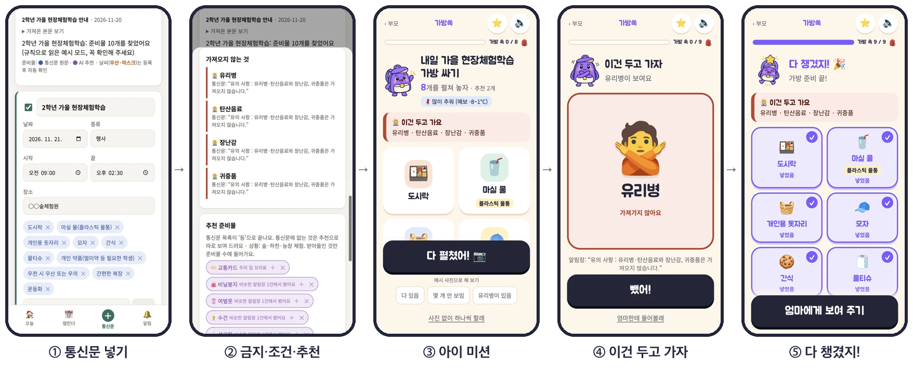
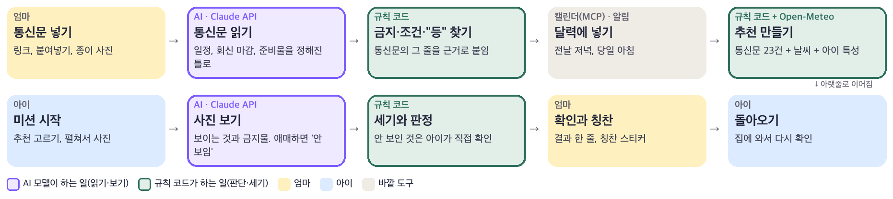

# 가방쏙 기획안

가정통신문에서 가방까지: 엄마가 넣으면, 아이가 스스로 챙겨요 · 엘리스 AI 챌린지 2026 · 성인 부문

## 1. 참가 정보

**팀명** 잘챙겼조　**구성원** 김호연(대표), 김동현

## 2. 문제 정의

**해결하고 싶은 문제**

- 가정통신문의 준비물은 한 줄 쉼표 나열이고, 조건과 금지는 괄호나 다른 줄에 숨어 있음. 실제 통신문의 한 줄: "준비물 : 개인 도시락, 간식, 물, 음료수, 멀미약, 비닐 봉투 (장난감 등 불가)"
- 초등학교 통신문 23건을 직접 읽은 결과: 한 줄 준비물 19건 중 **10건(53%)이 "… 등"으로 끝남**. 금지는 괄호, ※ 줄, 다른 항목에 흩어져 있고 학교마다 다름(수경: 6곳은 준비물, 1곳은 입장 제한)
- 그래서 엄마가 눈으로 읽고 머릿속으로 챙김 → 괄호 속 조건, "등"이 가린 것, 입고 가는 것을 놓치기 쉬움. (준비물을 빠뜨리는 빈도를 잰 통계는 찾지 못함 → 실제로 누락이 줄어드는지는 사용자 시험으로 확인할 가설)

**문제를 겪는 사람**

- 초등 저학년 아이와 엄마. '교육 준비물 파악·구입'은 어머니 담당이 52.3%(초등 이하 자녀를 둔 아버지 524명 설문)¹. 초등 학부모 조사의 '취학 뒤 어려움' 복수응답 4,268건 가운데 '숙제 지도 및 준비물 챙겨주기'가 976건(22.9%)²
- 1학년 담임의 조언은 "아이가 직접 다음 날의 준비물을 챙기고 가방에 넣도록"³. 그러나 아이 혼자 통신문을 읽고 챙기기는 어려움

## 3. 서비스 개요

**서비스명** 가방쏙 (가방 친구 '쏙이'가 안내)

**제작 목적** 통신문 읽기와 가방 싸기를 엄마 머릿속에서 꺼내, **아이가 스스로 하고 엄마는 확인하고 칭찬하는 일**로 바꿈

**기대 효과** ① 숨은 조건과 금지를 놓치지 않음 ② "등"이 가린 준비물을 추천으로 채움 ③ 아이는 스스로 해내고 칭찬받고, 엄마는 어디까지 됐는지 한눈에 봄

**쓰기 쉽게** PoC는 설치·로그인 없이 웹으로 열림. 통신문은 링크·붙여넣기·사진 어느 것이든 받고, 통신문이 없는 평소 일정(학원, 체육 있는 날)은 상황만 고르면 기본 준비물이 추천됨

**전체 그림** 찾기(수납) → **넣기(가방, 이번 PoC)** → 돌아오기(귀가, 한 화면 구현). 다음: 수납장 사진으로 물건 자리 찾기, 쏙이가 말을 거는 대화형 도우미, 학교 알림 앱·외부 캘린더 연동

## 4. 서비스 활용 방식

① 엄마가 통신문을 넣음(링크·글·사진) → 일정, 회신 마감, 준비물, '가져오지 않는 것'이 정리되고 달력과 알림(전날 저녁·당일 아침)에 들어감

② 통신문에 없는 것은 '추천'으로 따로 나옴(비슷한 통신문, 날씨·미세먼지, 아이 특성)

③ 아이가 미션으로 가방을 쌈: 추천 고르기 → 펼쳐서 사진 → 안 보인 것만 하나씩 → "다 챙겼지!"

④ 사진에 가져가면 안 되는 것이 보이면 "이건 두고 가자"(통신문 문장과 함께)

⑤ 엄마 화면에 결과가 남고 엄마는 칭찬 스티커를 붙임. 집에 오면 가져간 것을 다시 확인(돌아오기)

## 5. AI 활용 계획

- **Claude API(AI 모델)**: ① 통신문(글·사진)에서 일정과 준비물을 정해진 틀로 읽기 ② 펼친 준비물 사진에서 보이는 것과 금지물 찾기(애매하면 '안 보임'으로 답하게 함)
- **규칙 코드(모델 아님)**: 금지·조건·"등" 찾기와 근거 줄 붙이기, 추천, 개수 세기, "다 챙겼지" 판정, 달력 말투 → 자동 시험 54개로 고정. 규칙도 놓칠 수 있어 엄마 화면에 통신문의 그 줄을 같이 보여 주고 확인받음
- **MCP**: 캘린더와 가방쏙 규칙(통신문 읽기·챙길 것·캘린더 글)을 MCP 도구로 열어, 웹 앱이 일정을 넣고 AI 비서에서도 부를 수 있게 함　**Open-Meteo**: 날씨·미세먼지 예보
- **이렇게 나눈 이유**: 사진을 보는 모델은 손본 이미지에서 정답률이 크게 떨어졌다는 보고가 있음(GPT-4V 원본 79.6% → 편집 이미지 38.4%)⁴. 우리 사진으로 잰 값은 아니어서 사진만 믿지 않게 함 → 금지·조건·개수는 규칙이 맡고, 안 보인 것은 '없음'이 아니라 아이가 직접 확인. 아이는 AI와 직접 대화하지 않고, 약은 보호자 화면에만 나옴

- **지키는 것**: 사진은 저장하지 않고 확인할 때만 AI로 보냄(얼굴·이름표는 찍지 않게 안내). 통신문은 뽑아낸 일정·준비물과 근거 줄만 남김. 아이의 위치는 쓰지 않음(날씨는 정해 둔 동네의 예보)
- **확인 계획**(아직 재지 않음): 실제 사진 12장 이상과 엄마·아이의 사용 흐름으로 금지물을 놓친 수, 없는 것을 보인다고 한 수, 괜히 직접 확인하게 한 비율을 잼. 잠정 기준은 앞의 둘이 0건. 못 미치면 사진 확인은 빼고 '하나씩' 미션과 추천·금지 표시만 남김
- **생성형 AI 활용 범위**: (서비스) 통신문 읽기와 사진 보기 / (제작 과정) 조사·초안·코드·검토에 Claude·GPT, 마스코트 그림에 이미지 생성 AI. 결과는 팀이 확인하고 고침

## 6. 핵심 기능 (3가지)

① **통신문 → 일정·준비물·금지 정리**: 행사일과 회신 마감을 따로 일정으로 만들고, 준비물·조건·'가져오지 않는 것'을 통신문의 그 줄과 함께 보여 줌. 이번엔 안 가져가는 것은 엄마가 '이번엔 빼기'로 따로 둠(금지와 구분). 달력과 알림으로 이어지고, 구글 캘린더 링크·캘린더 파일로 내 폰 달력에도 넣음

② **"등"을 채우는 추천**: 실제 통신문 23건에서 본 준비물 + 날씨·미세먼지 + 아이 특성. "비슷한 알림장 3건에서 봤어요"처럼 근거를 붙이고, 받아들인 것만 셈. 통신문에서 찾은 금지 항목은 추천하지 않음

③ **아이 스스로 챙기기 미션**: 사진으로 한 번에, 안 보인 것만 하나씩. 금지물이 보이면 알림. 다 넣었을 때만 "다 챙겼지!". 엄마는 칭찬 스티커로 답함

## 7. 차별점

- **이미 있는 것**(스토어 설명 기준): 통신문에서 준비물을 뽑는 앱(리마인디 등), 목록과 사진을 대조하는 앱(TurtleWiz 준비물 체크), 체크리스트 앱(다 챙겼지?), 날씨 알림 앱(챙겨줘, 우산)
- **가방쏙이 다른 점**: ① '가져오지 않는 것'과 조건을 따로 뽑아 통신문 문장과 함께 아이 화면까지 가져감 ② 추천을 통신문과 섞지 않고 근거를 붙임 ③ 아이가 하고 엄마가 칭찬하는 두 사람의 흐름 ④ 가방 밖까지: 돌아오기(있음), 집 안 수납 찾기(설계). ①–③은 견준 앱들의 설명과 화면에서 찾지 못한 것
- 범용 AI 채팅에 통신문과 사진을 같이 주는 방법도 있음 → 가방쏙은 그 일을 **아이가 혼자 할 수 있는 화면**과 **근거를 보여 주는 규칙**으로 바꾼 것

## 8. 역할 분담

**김호연** 기획, 서비스 설계, AI 활용 설계(추천·금지 규칙), 아이 화면, 전체 합치기

**김동현** 개발·배포·운영(통신문 추출, 캘린더 MCP 연동, 날씨·알림, 서버)

---

**PoC** https://kimble125.github.io/chaenggyeojwo-ai-bag-check/ (설치·로그인 없이 눌러 보는 프로토타입 + 한눈에 보기). 공개 PoC는 예시 판: 통신문 글을 규칙으로 읽고 아이 미션과 엄마 칭찬까지 이어짐. 사진 확인은 준비된 결과, 달력은 브라우저 안 저장. Claude API와 MCP 연결(실제 판)은 코드가 있고 공개 주소에서는 돌리지 않음

**출처** ¹ 인구보건복지협회 설문(KBC 2026-11-15 보도) ² 장명림·김선미(2018), 2015년 초등 학부모 2,579명 조사 ³ 부산일보 2025-03-17 ⁴ HallusionBench(CVPR 2024). 통신문 23건: 초등학교 홈페이지 게시글을 팀이 읽음(2026-11-19)
